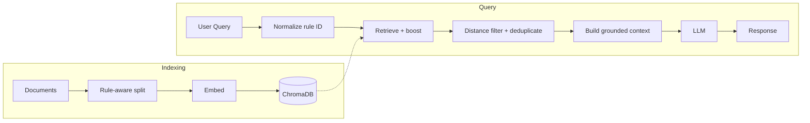

# Grounded RAG

## About

A retrieval-augmented generation system designed to keep an LLM strictly grounded to a controlled set of internal documents. The goal is to answer only from approved sources, refuse to guess when information is missing, and avoid leaking or hallucinating outside knowledge. SEI CERT documents are used here purely as a test corpus.

## Overview

This project explores controlled knowledge retrieval: ingest your own documents (PDF/Markdown), index them in ChromaDB, and ask questions with answers constrained to those documents. It focuses on retrieval engineering to prevent hallucinations, with citations back to the source passages used. Built with FastAPI and ChromaDB.

<p align="center">  </p>

## What it does / doesn't do

**Does**

- **Strict grounding** – answers only from retrieved passages in the indexed corpus; if something isn't there, it says so explicitly.
- **Source citations** – each answer references the source passages used for traceability.
- **Precise retrieval for structured docs** – detects rule/identifier patterns (e.g. `PRE30-C`) and pulls the relevant section directly.
- **Noise reduction** – configurable chunking, metadata-based boosting, and a distance threshold to filter weak matches.
- **Resilient ingestion** – incremental re-indexing, skip-and-continue on failures, and environment-driven configuration.
- **MCP-ready** – exposes `search`, `ask`, and `get_rule` tools via `mcp_server.py` so AI agents can query the grounded knowledge base.
- **Interactive use** – JSON API (`POST /chat`) plus a CLI (`make chat`).

**Doesn't (yet)**

- **No general knowledge fallback** – intentionally disabled to prevent hallucination on missing information.
- **No code analysis** – explains content from indexed documents, but does not scan source files or report violations with line numbers.
- **No conversation memory** – `session_id` is accepted but each request is independent.
- **Narrow corpus** – it only knows what you've indexed in `source_docs`. If information isn't present, it will say so rather than guessing.

## Key Challenges & Solutions

- **Rule chunks broken apart** – Naive header-based splitting fragmented rule definitions and their examples into separate chunks. *Solution:* Implemented rule-aware splitting that keeps each rule (definition + examples) intact, slicing at rule-id headers. Oversized rules are sub-split with the rule header repeated in every part.
- **Appendix swallowed by last rule** – The bibliography appendix was absorbed into the final rule chunk. *Solution:* Halt rule-based slicing at `Appendix`/`Bibliography`/`Glossary` boundaries and index them separately.
- **Unhyphenated rule IDs missed retrieval** – Queries like `pre31c` didn't match indexed rule metadata, leading to weak retrieval and occasional hallucination. *Solution:* Normalized rule IDs (e.g. `pre31c`, `PRE 31 C` → `PRE31-C`) before lookup and boosted the exact rule on demand.
- **Noise in retrieved context** – Distant chunks diluted the prompt and increased the chance of off-topic answers. *Solution:* Added a configurable distance threshold (rule matches bypass the filter) and deduplicated results.

## Requirements

- Python: 3.10–3.12 (uv installs it automatically if needed). 3.14 is not supported: ChromaDB uses Pydantic v1, which is incompatible with 3.14+.
- [uv](https://github.com/astral-sh/uv) – package and environment manager

## Installation

1. Install [uv](https://github.com/astral-sh/uv) (e.g. via the official installer):

   ```sh
   curl -LsSf https://astral.sh/uv/install.sh | sh
   ```

   Then ensure `~/.local/bin` is on your `PATH`, or install with pip: `pip install uv`.

2. From the repo root, create the venv and install dependencies:

   ```sh
   uv sync --extra dev    # creates .venv and installs deps + dev tools (ruff, pyright)
   ```

3. Activate the venv so you can use `python`, `pytest`, etc. without prefixing every command with `uv run`:

   ```sh
   source .venv/bin/activate   # macOS/Linux
   # Windows:  .venv\Scripts\activate
   ```

## Configuration

- Create `.env` file with variables mentioned in [.env.example](./.env.example)

- Use a folder named `source_docs` for your documents, or set the `COLLECTION_PATH` env variable to your folder path. To fetch docs from GitHub into source_docs, run the [github_downloader](./github_downloader/README.md) with a JSON file listing repo URLs: edit `github_downloader/urls.json` then run `python -m github_downloader`.

**Note:** The API accepts any markdown/pdf documents you provide. PDFs are automatically converted to markdown during indexing. The `source_docs` folder is not included in this repository—you must add your own documents.

- The vectordb uses persistent storage (default `./chroma_db`). Override with `PERSISTENT_STORAGE` in `.env` (see [.env.example](./.env.example)).

- File modification times are stored in a JSON file there (default `file_hashes.json`, override `HASH_FILE`) for incremental re-indexing. Format: [sample_file_hashes.json](docs/sample_file_hashes.json).

- Logging goes to standard output by default. Set `LOG_FILE` in `.env` (e.g. `LOG_FILE=app.log`) to write logs to a file.

## Run

With the venv activated (see Installation), from the repo root:

Run with: `python app.py`

Without activating the venv, prefix with `uv run`: `uv run python app.py`

## MCP Server

The repo exposes an MCP server via `mcp_server.py` with tools: `search`, `ask`, and `get_rule`.

Test it with the MCP Inspector:

```sh
bunx @modelcontextprotocol/inspector uv run python mcp_server.py
```

You can also add it to your MCP client config (e.g. Cursor, Claude):

```json
{
  "mcpServers": {
    "grounded-rag": {
      "command": "uv",
      "args": ["run", "python", "mcp_server.py"],
      "cwd": "/path/to/grounded_rag"
    }
  }
}
```

## Run with Docker (local)

From the repo root. One command (build + run, with `.env` and local `source_docs` / `chroma_db` mounted):

```sh
docker compose up
```

Then open http://localhost:8000/ (health) or http://localhost:8000/docs (API docs).

## Adding a new package

From the repo root (venv can be active or not):

```sh
uv add <package-name>
```

This updates `pyproject.toml` and `uv.lock`, and installs the package. Commit both files.

For a dev-only dependency (e.g. a test or lint tool):

```sh
uv add --dev <package-name>
```

To add a version constraint: `uv add "package>=1.0"`. After editing `pyproject.toml` by hand, run `uv lock` to refresh the lockfile.

## Architecture

RAG (Retrieval-Augmented Generation)

**Indexing Phase (One-time setup):**
Documents -> Chunks -> Embeddings + Indexing (VectorDB: ChromaDB)

**Query Phase (Per request):**
User Query -> Normalize rule ID (if present) -> Retrieve with rule boost + semantic search (distance-filtered, deduplicated) -> Build grounded prompt (retrieved context only) -> LLM -> Response



**Components:**

- **Chunking**:
  1. Rule-aware splitting: Slices markdown at rule-id headers (when present) to keep each rule's definition and examples together. Oversized rules are sub-split with the header repeated in every part.
  2. Recursive character splitting: [langchain_text_splitters.RecursiveCharacterTextSplitter](https://docs.langchain.com/oss/python/integrations/splitters) for further splitting and as a fallback for documents without rule headers (configurable via `CHUNK_SIZE`, `CHUNK_OVERLAP`).
- **Vector Database**: [chromadb](https://github.com/chroma-core/chroma) (embedding and indexing)
- **LLM**: [google-genai](https://github.com/googleapis/python-genai) (Gemini 2.5 Flash)

**Note:**

Docs are loaded from the collection folder at server startup (default `source_docs`, overridable via `COLLECTION_PATH`). Reload when you update docs.

ChromaDB automatically handles embedding and indexing when documents are added via the indexer. Retrieval uses semantic search with optional rule-id boosting and distance filtering.

## Sample retrieval

For a query that names a rule (e.g. one from a document in `source_docs`), the retrieval pipeline boosts the matching rule to the top (distance 0.0), then fills remaining results with semantic search and deduplicates. The context returned includes source labels for traceability. See [sample retrieval output](docs/sample_retrieval_output.md) for a sanitized example.

## Future improvement

### Core Stability

- **Distance-based filtering**: Use the distance returned by get_query_results in get_context (e.g. only include chunks with distance below a threshold, or within a narrow range)
- **Better error handling:** Add logging and retry logic for API calls

### Code Analysis (Core Value)

- **Code input endpoint**: Add `/analyze_code` endpoint for semantic code → rule retrieval (no AST parsing needed)
- **42 Integration**: Test against personal C projects and document security findings
- **Security report generation**: CLI tool to scan code and output markdown security reports

### Future (When Needed)

- **Metadata filtering**: Extend filtering using ChromaDB's `where` clause for source, date, or other metadata
- **Document automation**: Automate document updates and indexing (e.g., watch for new PDF releases)
- **Production optimizations**: Vector DB migration, performance improvements (only when real users exist)

## API Documentation

FastAPI automatically generates interactive API documentation:

- Swagger UI: http://127.0.0.1:8000/docs
- ReDoc: http://127.0.0.1:8000/redoc

## Testing

1. Start the server: `python app.py` (or `uv run python app.py` if the venv is not activated)

2. In another terminal, test the health endpoint:

```bash
./curl_scripts/test_health.sh
```

3. Test a conversation:

```bash
./curl_scripts/test_chat_endpoint.sh
```

or run multiple tests:

```bash
./curl_scripts/tests.sh
```

## Files Reference

- Main implementation: [app.py](app.py) – FastAPI app. RAG and vector DB in the [chroma/](chroma/) package
- Configuration: [pyproject.toml](pyproject.toml), [uv.lock](uv.lock), [.env.example](.env.example)
- Packages
  - [chroma/](chroma/) - ChromaDB client implementation with vector database operations
  - [github_downloader/](github_downloader/) - see [github_downloader/README.md](./github_downloader/README.md)
- Scripts: [scripts/](scripts/)
  - [reload_db.py](scripts/reload_db.py) - reload Chroma collection. Run: `python -m scripts.reload_db`
  - [remove_db_files.py](scripts/remove_db_files.py) - remove files from Chroma collection
- Curl scripts: [curl_scripts/](curl_scripts/)
  - [test_health.sh](curl_scripts/test_health.sh) – Test GET / endpoint
  - [test_chat_endpoint.sh](curl_scripts/test_chat_endpoint.sh) - Test POST /chat endpoint
  - [tests.sh](curl_scripts/tests.sh) - Multiple tests POST /chat endpoint

## References

- [Bun installation](https://bun.com/docs/installation)
- [Github modelcontextprotocol servers](https://github.com/modelcontextprotocol/servers)
- [Github modelcontextprotocol python-sdk](https://github.com/modelcontextprotocol/python-sdk)
